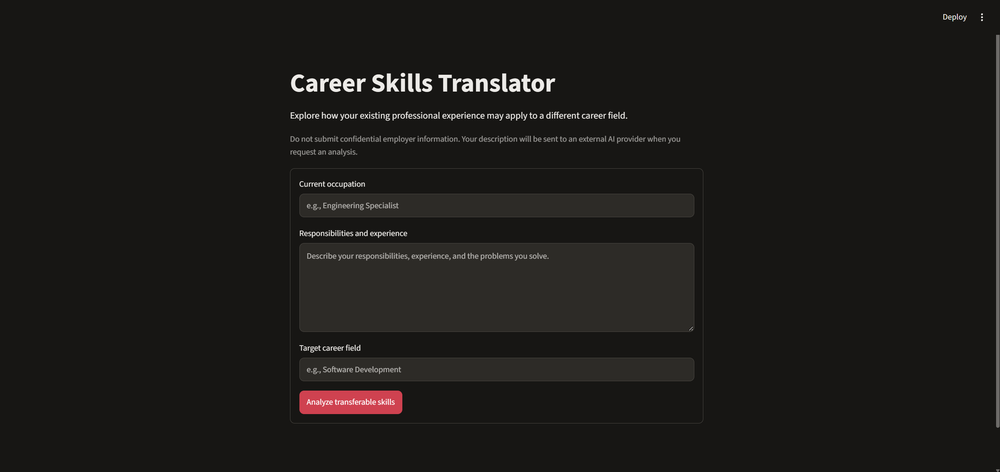
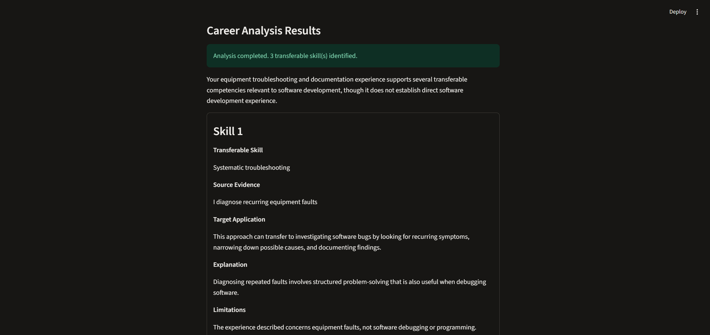
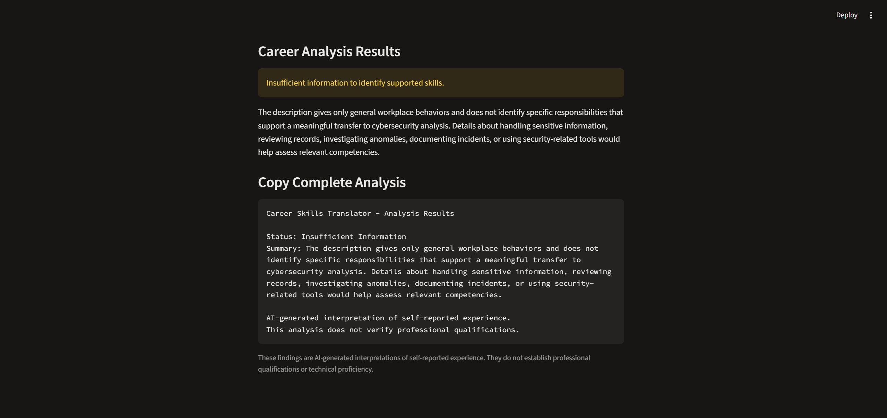

# Career Skills Translator

**COSC 4272 Senior Seminar | Lamar University**

Career Skills Translator is a browser-based application that helps people explore how experience from one occupation might apply to another career field. It uses an AI model to identify plausible transferable competencies, cite excerpts from the user's own description, explain target-field applications, and state limitations.

**Project status:** Functional MVP deployed on Streamlit Community Cloud with restricted access. Local automated testing, manual evaluations, and a successful hosted AI integration test have been completed.

## Features

- Enter a current occupation, professional responsibilities and experience, and a target career field.
- Validate required inputs and length limits before requesting an analysis.
- Request a live AI analysis using the OpenAI Responses API and the configured `gpt-6-luna` model.
- Display a summary and, for each identified competency, the skill name, source evidence, target application, explanation, and limitations.
- Copy the complete analysis as plain text.
- Report insufficient information when the described experience does not support a meaningful career translation.
- Handle common API errors without exposing raw provider errors to users.

The application does not verify employment history or determine whether someone is qualified for a particular job. It does not rewrite resumes, recommend certifications, or provide a skills-gap assessment.

## Technologies

- **Python** for application and analysis logic
- **Streamlit** for the browser interface
- **Pydantic** for validation and structured AI outputs
- **OpenAI Python SDK / Responses API** for model interaction
- **pytest** and Streamlit's `AppTest` for automated tests
- **Git and GitHub** for version control

Dependencies and supported version ranges are maintained in `requirements.txt` and `requirements-dev.txt`.

## Requirements

- Python 3.14.5 (the version used during local verification; other compatible versions have not been separately verified)
- An OpenAI API key with access to the configured model
- Internet access for live analysis

API requests may incur charges. The application does not automatically retry requests.

## Installation (Windows Command Prompt)

1. Clone the repository and enter the project directory:

   ```cmd
   git clone https://github.com/PhoenixPrimeGames/Career-Skills-Translator.git
   cd Career-Skills-Translator
   ```

2. Create and activate a virtual environment:

   ```cmd
   python -m venv .venv
   .venv\Scripts\activate
   ```

3. Install application dependencies:

   ```cmd
   python -m pip install -r requirements.txt
   ```

4. Provide an API key through one of these methods:

   - **Local Streamlit secrets:** Create `.streamlit/secrets.toml` and add:

     ```toml
     OPENAI_API_KEY = "your-api-key-here"
     ```

   - **Environment variable:** Set `OPENAI_API_KEY` in your local environment before starting the application.

   The `.gitignore` excludes `.streamlit/secrets.toml` and `.env`. **Never commit an API key.** For deployment, use the hosting provider's secret-management settings.

5. Launch the application:

   ```cmd
   python -m streamlit run app.py
   ```

   Open the address Streamlit displays, typically `http://localhost:8501`.

## Usage

1. Enter your **current occupation**.
2. Describe specific responsibilities, activities, and experience. Avoid confidential employer information.
3. Enter your **target career field**.
4. Select **Analyze transferable skills**.
5. Review each competency's supporting excerpt, possible target-field application, explanation, and limitations.
6. Use the **Copy Complete Analysis** section to copy the response as text.

**Input limits:** occupation 2–100 characters; experience 20–4,000 characters; target field 2–100 characters, after trimming surrounding whitespace.

If the input is too vague to support meaningful skills, the application may return **Insufficient Information** rather than producing speculative competencies.

## Testing

Install development dependencies:

```cmd
python -m pip install -r requirements-dev.txt
```

Run automated tests without making billable API requests:

```cmd
python -m pytest -v
```

**Last student-reported result:** 56 tests passed (November 15, 2026). The tests cover input validation, response schemas, evidence-excerpt verification, API error handling, and Streamlit UI behavior. They do not prove the semantic accuracy of generated translations.

Manual quality evaluation is documented in:

- [`docs/EVALUATION_PLAN.md`](docs/EVALUATION_PLAN.md): evaluation procedure and scoring criteria
- [`evaluation/scenarios.json`](evaluation/scenarios.json): ten fictional scenarios
- [`docs/EVALUATION_RESULTS.md`](docs/EVALUATION_RESULTS.md): first-attempt and regression findings
- `evaluation/results/`: preserved copyable result exports for individual attempts

In the initial ten-scenario evaluation, **nine first attempts passed and one failed** the approved rubric. The failed insufficient-information case, EV-09, was corrected by revising model instructions and passed a subsequent retest. EV-01 and EV-10 also passed selected post-revision regression tests. These observations are from a small fixed dataset and should not be interpreted as a statistical accuracy rate.

## Project Structure

| Path | Purpose |
| --- | --- |
| `app.py` | Streamlit input form, analysis invocation, and result display |
| `validation.py` | Career input validation |
| `schemas.py` | Pydantic response models |
| `analysis.py` | AI instructions, API interaction, and source-evidence checking |
| `tests/` | Offline automated tests |
| `evaluation/` | Fictional test cases and preserved evaluation outputs |
| `docs/` | Architecture, evaluation, and AI-assistance documentation |
| `requirements.txt` | Application dependencies |
| `requirements-dev.txt` | Development and test dependencies |

## Privacy and Limitations

The description submitted for analysis is sent to an external AI provider. Do not include sensitive personal information or confidential employer information. The application does not intentionally store input descriptions in its own database, but the external provider may process or retain submitted content under its applicable terms.

Source evidence is checked against the submitted description. That verifies that a quoted excerpt appears in the text, **not** that the experience or AI interpretation is independently true. Results must be reviewed critically, particularly when a target career requires specialist training, licensing, or credentials.


## Screenshots and Deployment

The following screenshots demonstrate the locally running application
using fictional career-transition examples.

### Input Form

The initial interface collects the user's occupation, professional
experience, and target career field.



### Successful Career Analysis

A fictional Engineering Technician example produces three transferable
competencies. Each skill includes source evidence, a possible target
application, an explanation, and limitations.



### Insufficient Information

When a fictional Office Assistant description provides only generic
workplace behaviors, the application explains that more specific
responsibilities are needed instead of inventing transferable skills.



These are demonstration screenshots, separate from the scored evaluation
attempts documented in `docs/EVALUATION_RESULTS.md`.

**Hosted application:** https://career-skills-translator-main.streamlit.app/

**Access:** Restricted to explicitly authorized viewers through Streamlit Community Cloud.

**Hosted verification:** On November 15, 2026, the student confirmed successful application startup, safe handling of missing API credentials, and a completed live AI analysis.

**API cost protection:** An enforced $5 spending limit is configured for the OpenAI API project. This does not guarantee that usage cannot slightly exceed the threshold during enforcement.


## Possible Future Enhancements

After the MVP and submission requirements are complete, potential improvements include optional session-only result persistence, more extensive evaluation across occupation types, and broader accessibility testing. These are ideas for later review, not implemented features.

## Academic Documentation

This application was developed as an AI-assisted software development project. The development record, including AI assistance and student review, is maintained in `docs/AI_usage_log.md`. Requirements and architecture decisions are documented separately in `requirements.md` and `docs/ARCHITECTURE.md`.
